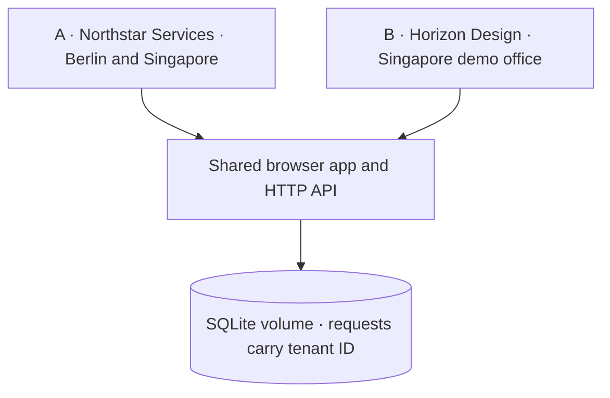

# Lab 5 — IT Equipment Desk design

I chose work equipment requests because the same task comes up in different offices. The service is for companies with staff in Europe and Asia. An employee requests a mouse, second monitor, keyboard or USB flash drive with a reason, then sees whether their manager and local IT have approved it. A busier company could pay for a higher number of requests under review at the same time.

## Workflow

1. The employee selects equipment and enters a name, employee ID, office and explanation. All fields are required. The name, ID and office must match the demo employee account. A reason needs at least three words and 15–300 characters. The manager judges the explanation.
2. The API creates the request in `pending_manager` and assigns the employee’s direct manager from the account configuration. The manager approves the request or declines it with a comment. A manager decline closes the request at this step.
3. A manager approval changes the request to `pending_it`. It appears for IT at the employee’s office. Berlin maps to Europe and Singapore maps to Asia. IT can approve the request or decline it with a comment.
4. The employee can see the progress and final status. If a request is declined, the employee sees the reason under the manager or IT reviewer who entered it. The server requires a non-blank comment of up to 200 characters to close a request as declined.

Each request has an ID, company, employee ID and name, assigned manager, office, equipment, reason, status and creation time. The service records each reviewer's decision and its time, with a comment required for a decline.

## Tenant and role checks

The app obtains the company, role and assignment from the verified demo token. An employee sees their own requests. A manager sees requests assigned to them. IT reads only manager-approved requests for its own office and company. The server checks the stage again before each decision. A foreign tenant or an unassigned manager or IT account gets `404 request_not_found`. Early approval by the same company’s correct IT account gets `409 wrong_approval_stage` and leaves the record unchanged.

## Plans and checks

Starter (A) allows two open requests across its offices. Plus (B) allows five. Requests awaiting either approval count as open. Final approval or decline frees the slot. The API counts and inserts in one SQLite write transaction. At the limit, the API returns HTTP 409 with `open_request_limit_reached`, usage and allowance. The following checks use a fresh named volume.

| Check | Start and action | Expected |
| --- | --- | --- |
| Normal use | Each company starts empty. Submit, get manager approval, then get local IT approval. | Same request follows `pending_manager`, `pending_it`, `approved`. Early or incorrectly assigned approvals are rejected. |
| Tenant isolation | B has a Singapore request awaiting IT. A uses its own employee and approver accounts on that ID. | A receives 404. B can still retrieve its unchanged record. Sharing the city does not share records. |
| Plan limit | A has two open requests across Berlin and Singapore. B has two open requests. Attempt a third in both companies. | A receives 409 and retains 2/2. B receives 201 and reaches 3/5. Closing an A request makes a slot available. |
| Decline with explanation | Use one request at manager review and a second at IT review. Attempt to decline each without a reason and then with a reason. | The API returns 400 for a missing reason and keeps the request pending. A valid decline closes the request and the employee sees the reason. A manager decline skips IT. |
