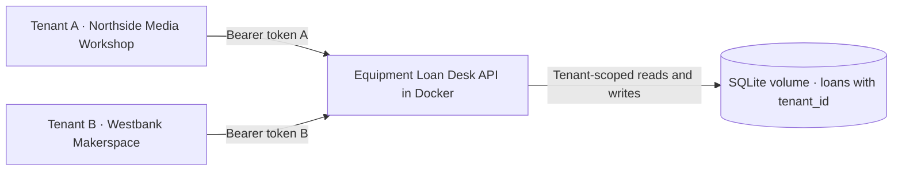

# Lab 5 — Equipment Loan Desk design

## Idea and customers

Equipment Loan Desk is a shared service for small organisations that lend cameras, microphones, tools or kits. Northside Media Workshop and Westbank Makerspace represent two independent customers with the same recurring problem of tracking which items are still checked out. Their staff open a loan with an asset code and borrower reference, then close the loan when the item comes back. A busier workshop could pay for a higher limit on active loans.

## Workflow and stored records

1. Staff send an asset code and a synthetic borrower reference using their organisation's demo token.
2. The API checks the active allowance and verifies that the asset has no active loan in that organisation. It creates a record and returns the new ID and checkout time.
3. Staff list their organisation's loans or retrieve a single loan to see whether it is active or returned.
4. When staff record a return, the API saves the return time. The returned record stays in history and its slot becomes available for another checkout.

Each loan stores an ID, tenant ID, asset code, borrower reference, checkout time and optional return time. A null return time means the loan is active. The server assigns the owner and timestamps. Asset codes are scoped to the issuing organisation. The workshop inputs and borrower references in the prototype are synthetic.

## Shared application and ownership

The application verifies the bearer token and obtains a tenant and plan from its server configuration. It assigns the tenant ID on checkout. Listing uses a tenant filter. Reading or returning a specific loan requires both the authenticated tenant ID and the loan ID. A missing or foreign loan yields the same `404 loan_not_found` response. A repeated return yields the existing returned record.

## Plans

| Plan | Tenant | Active loan allowance |
| --- | --- | ---: |
| Starter | A | 2 |
| Plus | B | 5 |

Checkout consumes one slot only when insertion succeeds. The API counts active loans and inserts the new one in one SQLite write transaction. At the allowance, checkout returns HTTP 409 with `active_loan_limit_reached`, the plan, the observed active count and the limit. Returning an item releases one slot. Total historical rows can exceed the active allowance.

## Acceptance checks

| Check | Starting conditions | Action | Expected result |
| --- | --- | --- | --- |
| Normal use | Both tenants can authenticate. Both start with empty loan histories. | Check out `CAM-01` under both tenants, read their own loans, then return both. | Each checkout returns 201. Owned read, list and return return 200. Each ends with zero active loans and one returned row. |
| Tenant isolation | B has an active `SOLDER-01` loan. A knows the ID. | B reads it, then A attempts to read and return it. B reads it again. | A gets 404 on both attempts. B's 200 responses are identical and its loan remains active. |
| Plan limit | A has no active loans. B has its isolation-test loan. | Fill A to two and attempt a third checkout. Bring B to three. Return one A loan and retry A's third item. | A's third request gets 409 and the before and after lists match. B's third active loan gets 201. A succeeds after a return frees a slot. |
